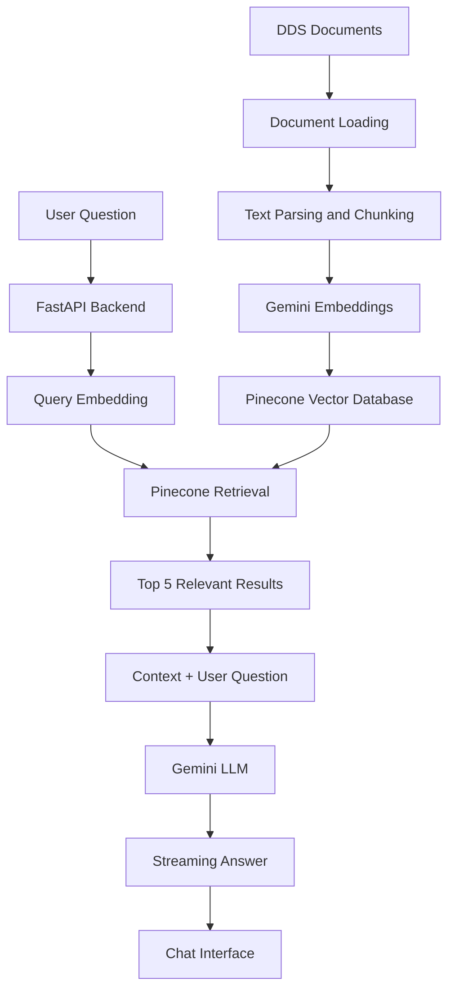

<div align="center">

# 💬 DDS FAQ Chatbot

### Your AI-powered assistant for the Decoding Data Science community.


<br/>

<a href="https://dds-faq-chatbot-static.vercel.app/">
  
</a>
<a href="https://github.com/Sumaya04122006/DDS-FAQ-Chatbot">
  
</a>

<br/><br/>


</div>

---

## 📌 About the Project

The **DDS FAQ Chatbot** is an AI-powered chatbot built to help participants of **Decoding Data Science (DDS)** find answers to common questions about its activities, challenges, and available information.

Instead of manually searching through different documents, participants can simply ask a question in everyday language and receive an answer based on the available DDS knowledge base.

The project uses **Retrieval-Augmented Generation (RAG)** to retrieve relevant information before generating an answer.

The goal is simple:

**Make DDS information easier to find and access.**

## ✨ Features

- 💬 **Natural Language Questions** – Ask questions in everyday language.
- 🧠 **RAG-Based Answers** – Retrieves relevant information before generating responses.
- 🔎 **Semantic Search** – Finds information based on meaning, not just exact keywords.
- ⚡ **Streaming Responses** – Answers are delivered progressively.
- 📚 **Source References** – Displays relevant document information when available.
- 🛡️ **Context-Based Answers** – Uses retrieved DDS information to guide responses.
- 🚫 **Fallback Responses** – Handles questions when the required information is not available.
- 🔐 **API Rate Limiting** – Includes basic request limiting.
- 🌐 **Web-Based Interface** – Accessible through a deployed application.

---

## 🛠️ Technology Stack

| Technology | Purpose |
|---|---|
| Python | Main programming language |
| FastAPI | Backend API |
| LlamaIndex | RAG pipeline and retrieval |
| Google Gemini | AI answer generation |
| Gemini Embeddings | Text embedding generation |
| Pinecone | Vector database |
| Uvicorn | ASGI server |
| HTML, CSS, JavaScript | Chat interface |
| Vercel | Frontend deployment |

---

## 🧠 How It Works

The chatbot follows a **Retrieval-Augmented Generation (RAG)** workflow.

Instead of asking an AI model to answer using only its general knowledge, the application first searches the DDS knowledge base for relevant information.

### 🔄 RAG Architecture



### ⚙️ Workflow Explanation

**1. Document Ingestion**

DDS information is stored in Markdown documents inside the `data/` directory.

**2. Text Processing**

LlamaIndex loads the documents and splits the content into smaller chunks.

Current configuration:

- Chunk size: 800
- Chunk overlap: 100

**3. Embedding Generation**

Google Gemini Embeddings converts the text chunks into numerical vectors.

**4. Vector Storage**

The generated vectors are stored in Pinecone for similarity-based retrieval.

**5. User Question**

A participant enters a question through the chatbot interface.

**6. Information Retrieval**

The system searches Pinecone and retrieves the five most relevant results.

**7. Answer Generation**

The retrieved information is passed to Gemini along with the user's question.

The model is instructed to use the provided context and avoid making up information.

**8. Streaming Response**

The generated answer is streamed back to the frontend, with relevant source information displayed when available.

---

## 📂 Project Structure

```text
DDS-FAQ-Chatbot/
│
├── data/
│   └── DDS knowledge base (.md files)
│
├── static/
│   └── index.html
│
├── core.py
│   └── Gemini and Pinecone configuration
│
├── ingest.py
│   └── Document loading, chunking,
│       embedding and Pinecone ingestion
│
├── server.py
│   └── FastAPI backend, RAG retrieval,
│       response streaming and API routes
│
├── check.py
│   └── Project checking utility
│
├── requirements.txt
│   └── Python dependencies
│
└── .gitignore
```

---

## 🚀 Getting Started

Want to run the project locally? Follow these steps.

### 1. Clone the Repository

```bash
git clone https://github.com/Sumaya04122006/DDS-FAQ-Chatbot.git

cd DDS-FAQ-Chatbot
```

### 2. Create a Virtual Environment

```bash
python -m venv venv
```

Activate it:

**Windows**

```bash
venv\Scripts\activate
```

**macOS / Linux**

```bash
source venv/bin/activate
```

### 3. Install Dependencies

```bash
pip install -r requirements.txt
```

### 4. Configure Environment Variables

Create a `.env` file in the project root.

```env
GOOGLE_API_KEY=your_google_api_key
PINECONE_API_KEY=your_pinecone_api_key

PINECONE_INDEX=dsc-faq

LLM_MODEL=gemini-3.6-flash
EMBED_MODEL=gemini-embedding-001
```

You will need:

- A Google AI API key for Gemini.
- A Pinecone API key for vector storage.

**Important:** Never upload your actual API keys to GitHub.

### 5. Add Knowledge Base Documents

Place your DDS knowledge-base Markdown files inside the `data/` folder.

Example:

```text
data/
├── challenge_information.md
├── eligibility.md
├── rules_and_guidelines.md
├── deadlines.md
└── judging_criteria.md
```

These are example filenames. Use the actual documents you want to index.

### 6. Run Document Ingestion

```bash
python ingest.py
```

This process:

1. Loads the Markdown documents.
2. Splits the content into smaller chunks.
3. Generates embeddings using Gemini.
4. Creates the Pinecone index.
5. Uploads the vectors in batches.

⚠️ **Important:** The current ingestion script deletes and recreates the configured Pinecone index when run. Do not run it against an index containing data you need to preserve.

### 7. Start the Application

```bash
python server.py
```

Open your browser:

```text
http://localhost:8000
```

Backend health check:

```text
http://localhost:8000/healthz
```

---

## 🔑 Environment Variables

| Variable | Description | Default |
|---|---|---|
| `GOOGLE_API_KEY` | Google Gemini API key | Required |
| `PINECONE_API_KEY` | Pinecone API key | Required |
| `PINECONE_INDEX` | Pinecone index name | `dsc-faq` |
| `LLM_MODEL` | Gemini generation model | `gemini-3.6-flash` |
| `EMBED_MODEL` | Gemini embedding model | `gemini-embedding-001` |
| `PORT` | Server port | `8000` |
| `RATE_LIMIT_PER_MIN` | Requests per IP per minute | `15` |
| `ALLOWED_ORIGINS` | Allowed frontend origins | `*` |
| `EMBED_BATCH` | Ingestion batch size | `80` |
| `EMBED_PAUSE` | Delay between ingestion batches | `65` |

For production, configure `ALLOWED_ORIGINS` to your actual frontend domain instead of allowing all origins.

---

## 🔌 API Documentation

The backend is built using FastAPI.

| Method | Endpoint | Description |
|---|---|---|
| GET | `/` | Serves the application interface |
| GET | `/healthz` | Checks backend availability |
| GET | `/config.js` | Provides frontend API configuration |
| POST | `/api/chat` | Accepts questions and streams responses |

### Example Request

```json
{
  "message": "What are the challenge requirements?",
  "history": []
}
```

The `/api/chat` endpoint returns a Server-Sent Events (SSE) stream containing response updates, source information, and completion events.

---

## 🌐 Live Demo

<div align="center">

### Try the DDS FAQ Chatbot!

<a href="https://dds-faq-chatbot-static.vercel.app/">
  
</a>

</div>

Ask questions about DDS and get answers based on the available knowledge base.

---

## 🧪 Testing

Here are some example questions to test the chatbot:

| Category | Example Question |
|---|---|
| Challenge Details | What is the DDS challenge about? |
| Eligibility | Who can participate? |
| Rules | What are the participation rules? |
| Deadlines | When is the submission deadline? |
| Judging | How will projects be evaluated? |
| Missing Information | Ask something not covered in the documents. |

The expected behaviour is to retrieve relevant information and answer from the available documents.

If the information is missing, the chatbot should use its fallback response instead of inventing an answer.

---

## 🔮 Future Improvements

Some areas I would like to explore further:

- Expand the knowledge base with more DDS resources.
- Improve retrieval quality and answer accuracy.
- Add more detailed source references.
- Expand testing with more questions and edge cases.
- Improve the user interface and mobile experience.
- Add better monitoring and error handling.

---

## 📚 What I Learned

Building this project gave me an opportunity to put what I had learned about RAG into practice.

Some of the things I worked with include:

- Building a RAG application from scratch.
- Connecting Gemini with LlamaIndex.
- Generating and storing vector embeddings.
- Working with Pinecone for semantic search.
- Creating APIs using FastAPI.
- Implementing streaming responses.
- Handling API rate limits.
- Deploying an AI application for actual users.

Most importantly, I got to take what I learned earlier and build something independently for a community I am part of.

---

## 🙌 Acknowledgements

A special thank you to **Mr. Mohammed Arshad, Founder of Decoding Data Science (DDS)**.

I first learned how to build RAG-based chatbots during the DDS AI Accelerator Bootcamp, where I also built **NEXA, the DDS HR chatbot**.

That experience gave me the foundation to build this FAQ chatbot independently from scratch later.

Thank you for teaching us, guiding us, and encouraging us to put what we learn into practice.

Built for the DDS community as part of the **DDS November Challenge**.

---

## 👩‍💻 Author

<div align="center">

### Sumaya Fathima

Bachelor of Information Technology | AI Specialization

<a href="https://github.com/sumayafathima04122006-oss">
  
</a>
<a href="https://www.linkedin.com/in/sumaya-fathima-7148063a9/">
  
</a>

<br/><br/>

**Built with curiosity, code and a little bit of persistence. 💚**


</div>
